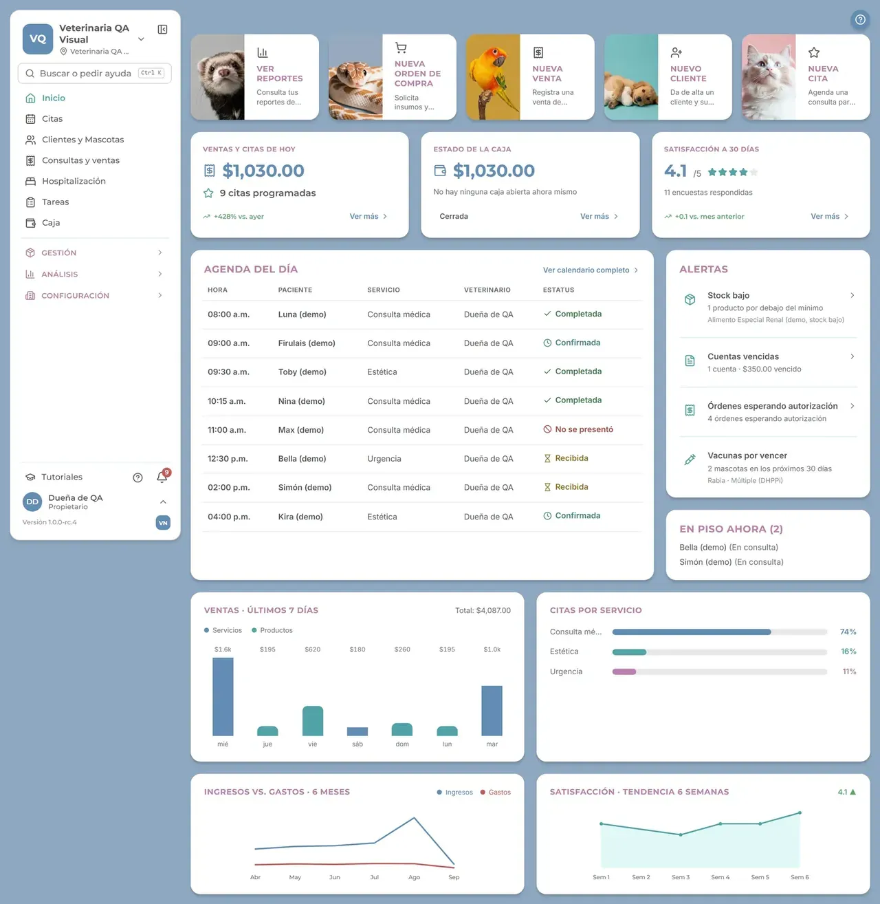
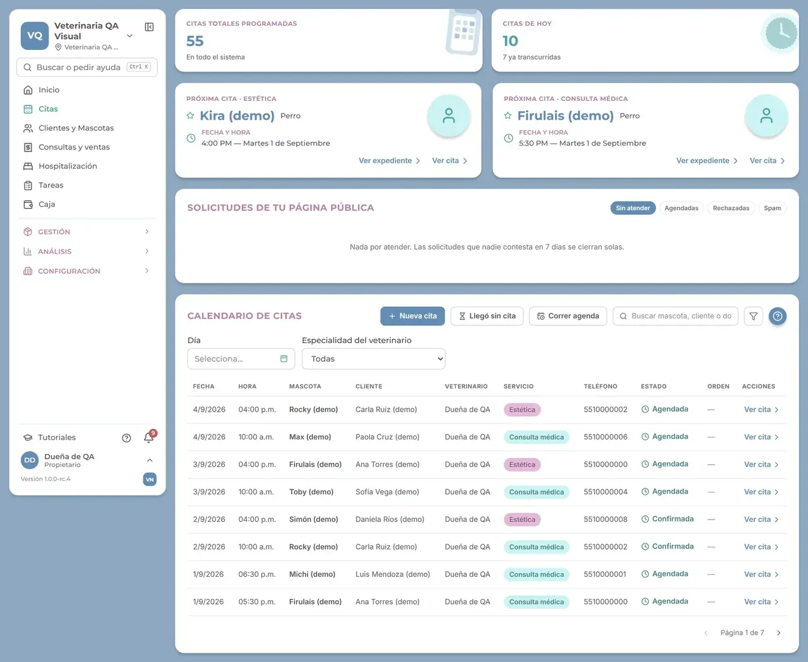
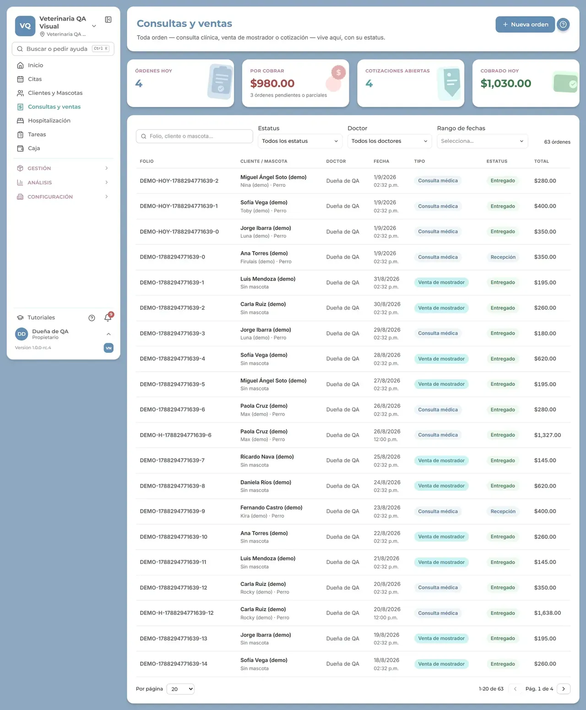

# VetNova — multi-tenant clinic demo

## The real product

*Real product, demo tenant with fictional data.*







> Public mini-demo with fictional data. The full product is private; access on request: carrerabernal@gmail.com

## Live demo

https://carrerable.github.io/vetnova-demo/

## What it demonstrates

- Two fictional clinics in one store, with three roles each (admin, veterinarian, reception).
- Tenant isolation: every read goes through a context `{ tenantId, userId }`, and another clinic's data answers `403: blocked by tenant policy (simulated RLS)`.
- Role permissions: reception cannot read medical records (`403: missing permission records.read`).
- Appointment rules: no overlap for the same veterinarian and only inside 09:00-19:00. Appointments are kept in memory and in `localStorage`.
- An "Isolation test" panel that shows the kind of row level security policy used in the real product.

## What is fictional and what is real

All clinics, people, pets and records are fictional, and the isolation here is simulated in TypeScript; the real product enforces it in the database. No code was copied from the real product; this demo is written from scratch.

## Run locally

```bash
npm ci && npm run dev
```

Add `?lang=es` for Spanish.

## Tests

```bash
npm test
```

## How it was built

Code written with Claude Code under my specs and code review; I designed the behavior, wrote the acceptance tests and verified the result.

## Case study

https://carrerable.github.io/en/projects/vetnova/

## License

MIT
